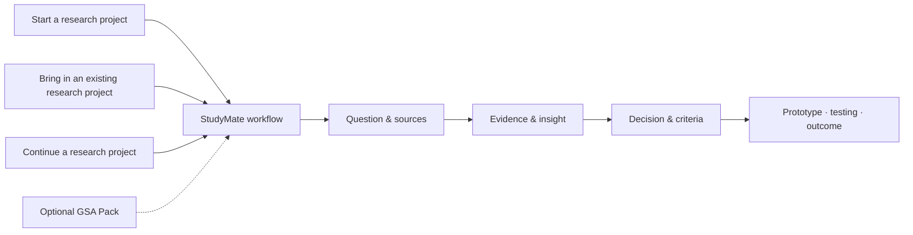

# StudyMate

[中文版 →](README.md)

StudyMate was previously called Threading. Existing calls remain aliases;
existing local folders need no rename and technical paths remain compatible.
See [Branding and compatibility](docs/BRANDING.md).

**An Agent companion from questions and research to evidence-led design.**

> **StudyMate is an Agent-native, evidence-led project workflow for Research and Design.**
> It connects questions, research, decisions, prototypes and testing into a working
> chain that can keep a Research and Design project moving.

StudyMate runs directly in Codex and Claude Code. The repository is the complete
project workflow; the included StudyMate Skill makes that workflow callable from
other Agent workspaces.

First use: say **Start StudyMate**. Ideas, existing material and a concrete
problem can coexist; you do not need to learn command names. The Agent helps
complete one useful task and leaves a way to continue in another conversation.
Students can bring course briefs, requirements, rubrics/ILOs, teaching slides,
readings and their own goals, or authorise inspection of named Canvas/LMS pages.
Research notes, Figma, prototypes, test records and chat exports also work.
Course-site access depends on the host's tools; relevant uploads/exports are a fallback.

New work progresses through goals/context, question framing, research, synthesis,
insights/criteria, concepts, then prototyping/testing/iteration. The Agent checks
what has actually been done: idea/course-only projects start with research;
existing projects join at their supported stage. See [Project flow](docs/PROJECT_FLOW.md).

## What can I choose on first use?

After `Start StudyMate`, the Agent offers these conversational entries when
needed. Prefer clickable native questions when the host exposes a permitted
tool, with numbered-text fallback. Explain your task in your own words if useful:

| Entry | Fits | First result |
|---|---|---|
| Try the example | Explore without importing personal material | Synthetic brief/idea review, framing and research preparation |
| Start my project | An interest, idea, brief or course requirement | Working question, known/unknown boundaries and first research plan |
| Bring in existing work | Sources, research, analysis or design already exist | Supported-stage assessment, upstream evidence gaps and a next move |
| Continue my project | A project is already saved | Resume Current State and a relevant handoff in another conversation |

Ideas, material and needs can coexist. Choices depend on actual progress; new
projects begin with research rather than a prototype/testing menu.
Choices orient the entry/stage/task; understanding the actual idea needs open
input. The host provides native UI; repository instructions cannot create a
missing tool or override its current mode restrictions.

The current demo uses a synthetic welcome-card idea in a shared learning space:
choose a requirements map or question clarification, review the basis, then
prepare a minimal investigation. It contains no real interviews, findings or
test results. "Show later stages" explains missing inputs and possible work;
it does not simulate completed empirical research or create a personal workspace.

Real-project choices change with the stage: source review/research planning,
evidence analysis, opportunities/criteria, concepts, then prototyping/testing
and iteration. At handoff, choose continue, change task, inspect sources or end.
See [User journey and choices](docs/USER_JOURNEY.md) for the step-by-step flow.

## At a glance



| Layer | Role |
| --- | --- |
| Research project | The user's own Research and Design work: questions, research, design, prototypes, testing and outcomes |
| Managed Workspace | Stores the research project's context, evidence, decisions, iteration records and outputs |
| StudyMate core | Provides the workflow, rules, methods, templates, Dashboard and local project space |

## What you can do with StudyMate

Here, a “research project” means the user's own Research and Design project,
such as a design research, service design or product design project.

- **Move a complete Research and Design project forward:** begin with a brief, research question or existing progress, then continue through design development, prototyping, testing and outcome.
- **Clarify research and design directions:** compare research questions, design opportunities or concept directions, showing the evidence, risks and open questions behind each one.
- **Turn research material into usable insights:** distinguish evidence, interpretation and insight across interviews, observations, literature, PDFs, images and project records, then form Actionable Insights without presenting assumptions as findings.
- **Move from insight to design:** translate Insights into design opportunities, design criteria, concepts, prototype briefs and testable questions.
- **Find gaps in design progress:** identify broken links between evidence and insight, criteria and concepts, or prototypes and testing, including unsupported claims and assumptions.
- **Design and review prototype testing and iteration:** define what a prototype can test, separate participant response, researcher interpretation and design decision, then shape the next iteration.
- **Review project communication and evidence:** check whether a Project Narrative, presentation, project document or reflection clearly connects its argument, evidence, decisions, limitations and design progress.
- **Select and apply Research and Design methods:** choose methods for a specific research question and make their inputs, outputs, limitations and next verification step explicit.
- **Keep a traceable project memory:** let later prototypes, tests, presentations and documents return to earlier evidence, decisions and changes of direction without repeatedly reconstructing the whole project.

## Get started

### 1. Clone

Paste this into a terminal (PowerShell on Windows or Terminal on macOS):

```bash
git clone https://github.com/51younglowkey/StudyMate.git
cd StudyMate
```

Without Git, use **Code → Download ZIP** on GitHub and extract the folder.
The existing update tools use a Git clone. ZIP users need to acquire new Core
files manually while preserving private `projects/local/` records.

### 2. Open StudyMate

Select the downloaded StudyMate folder as a local project/workspace in Codex
or Claude Code, then start a new conversation in that folder. A workspace is
the directory the Agent is working in. First use checks Python/file capabilities
and attempts Skill registration; successful registration allows use in other
directories. Approve the bounded file operation if your environment requests it.

Readiness is visible as `STUDYMATE / WELCOME` plus guidance about your task.
If it does not load, ask the Agent to read this folder's AGENTS.md and follow
docs/AGENT_ONBOARDING.md. Other hosts and limits are listed in
[Agent compatibility](docs/AGENT_COMPATIBILITY.md).

### 3. Bring in your research project

Use one entry, or describe your problem directly:

```text
Start StudyMate
```

For example: "I have a service design idea, teaching slides and assignment
requirements. Connect the requirements to my goal and help me move one task forward."
The Agent asks only what is needed, proposes and confirms the title/destination,
then produces a useful result such as a requirements map, working question,
evidence gap, comparison or test plan. Sources can stay in their original
locations; project knowledge is private in Git-ignored `projects/local/<slug>/`.

Start another conversation in the same folder with "Continue <project>, working
on <task>". The Agent reads Current State and an independent handoff. Concurrent
outputs remain separate; shared records need coordinated reconciliation.
Existing new/adopt/continue commands remain available.

### Update StudyMate

```bash
python3 90_scripts_tools/threading/update_threading.py
python3 90_scripts_tools/threading/update_threading.py --apply
python3 90_scripts_tools/threading/update_threading.py --apply-workspaces
```

The update uses two review gates: it updates the Core and shows the resulting
Compatibility Plan before preserving project records, adding missing schema
files and writing an Upgrade Report. You can also say `Update StudyMate and
reconnect my existing projects`.

After updating from v0.2, reopen StudyMate once. The new Agent instructions will
automatically check whether existing projects need to be reconnected.

## Example

The following is synthetic and does not represent real research findings.

You can say:

```text
Here are my research summary, two design directions and one round of prototype
testing notes. Compare the directions and find the missing connections in my
Design Progress.
```

StudyMate will return an analysis shaped like this:

```text
DESIGN DIRECTION REVIEW

Direction A      [supporting evidence] · [main risk]
Direction B      [supporting evidence] · [main risk]

Progress gaps
1. [an insight has not yet been translated into design criteria]
2. [a concept decision is not traceable to research evidence]
3. [the prototype test checks usability but not the main project claim]

Revision focus   [the most important connection to strengthen next]
```

The actual analysis cites only the research material the user has allowed
StudyMate to inspect and distinguishes existing evidence, analytical judgement
and work still requiring verification.

## Optional extension: GSA Pack

The GSA Pack adds two capabilities for Design Innovation-related study:

- **Academic methods:** Semester taught methods, Provotyping and Reflection Document guidance-video analysis.
- **Criteria-based review:** review presentations, Reflection Documents and other project documents against Stage 3 ILOs, criteria, rubric and evidence requirements, then identify improvement priorities.

```text
Load the GSA Pack
Use Design Innovation methods to analyse this research project
Use the GSA Pack to review my presentation
Check whether this Reflection Document addresses the relevant ILOs
```

The GSA Pack is an independent academic aid. It does not represent an official
position of Glasgow School of Art and does not replace current official
assessment sources or final assessment.

## Project boundary

The public repository provides only the reusable core. Personal research
material, participant data, private correspondence, complete AI conversations
and restricted course originals remain in the user's own local space. StudyMate
inspects only sources the user has authorised and keeps project knowledge in the
user's own Managed Workspace.

## Continue reading

- [Quickstart](docs/QUICKSTART.md) — install and start StudyMate.
- [Agent onboarding](docs/AGENT_ONBOARDING.md) — bring a research project into StudyMate.
- [Materials intake](docs/MATERIALS_INTAKE.md) — course files, project materials and LMS pages.
- [Session handoff](docs/SESSION_HANDOFF.md) — continue one project across conversations.
- [Agent compatibility](docs/AGENT_COMPATIBILITY.md) — entry files, capabilities and limitations.
- [Text Dashboard](DASHBOARD.md) — view the research project's current working state.
- [Capabilities](docs/CAPABILITIES.md) — browse the full natural-language capability guide.
- [Chat reconciliation](docs/CHAT_RECONCILIATION.md) — handle project conversations and full exports from large language models.
- [Compatibility upgrade](docs/COMPATIBILITY_UPGRADE.md) — update StudyMate and reconnect existing project records.
- [GSA Pack](packs/gsa/README.md) — explore Design Innovation methods and criteria-based review.

StudyMate is an independent project. Code uses the MIT License; original
documentation, templates and examples use CC BY 4.0.
