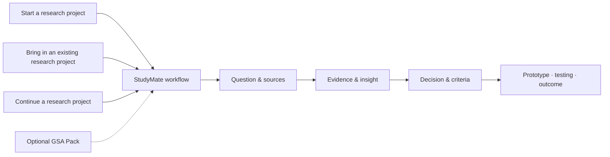

# StudyMate

[English version →](README.en.md)

StudyMate 原名 Threading。旧启动口令仍可用；已有本地文件夹不用改名，
技术路径保持兼容。名称与兼容说明见 [Branding](docs/BRANDING.md)。

**让 Agent 陪你从问题与调研走向有依据的设计。**

> **StudyMate 是一个面向 Research and Design 的 Agent-native、evidence-led 项目工作流。**
> 它帮助研究与设计项目把问题、研究、决策、原型和测试连接起来，形成一条可以持续推进的工作链。

StudyMate 可以直接在 Codex 和 Claude Code 中使用。
StudyMate 本体是完整的项目工作流；随仓库提供的 StudyMate Skill 是它在不同 Agent workspace 中的调用入口。

第一次使用只需说 **“启动 StudyMate”**。你可以同时带着想法、已有材料和具体需求，
不用先记功能名。Agent 会帮你选择一份有用的材料，完成第一项工作，并留下下次接续的方法。

学生可以提供课程 brief、作业要求、评分标准/ILOs、教学 PPT/PDF、阅读材料，
再说自己的目标或卡点；也可以提供 Canvas 等课程页面链接，授权检查指定页面。
自己的研究笔记、Figma、原型、测试记录和聊天导出也可以。没有材料同样能开始。
课程网站的读取取决于当前 Agent 的访问能力，无法访问时可上传或导出相关内容。

新项目按 **理解目标与要求 → 明确问题 → 调研 → 分析综合 → 洞察与设计标准 →
概念探索 → 原型、测试与迭代** 推进。Agent 先判断已经做过什么；只有想法和课程
资料时先帮你开展调研，已有项目则从有依据的阶段接续。见 [项目流程](docs/PROJECT_FLOW.md)。

## 第一次可以怎么选？

打开下载后的文件夹，在 Agent 对话中说 `启动 StudyMate`。需要引导时，Agent 提供
以下入口。宿主提供且允许原生选择工具时，会优先显示可点选的选择框；不支持时
改用文字选项。你也可以直接用自己的话说明需求：

| 选择 | 适合什么情况 | 你会得到什么 |
|---|---|---|
| 1. 先体验示例 | 还不确定怎么用，不想先导入自己的资料 | 用合成 brief 和想法体验问题梳理、要求对应与调研准备 |
| 2. 开始自己的新项目 | 有兴趣、想法、brief 或课程要求 | 工作问题、已知/未知与第一步调研计划 |
| 3. 接入已有项目 | 已有资料、调研、分析或设计工作 | 阶段判断、前序依据检查与一个合适的下一步 |
| 4. 继续已有项目 | 已保存项目，希望开新对话接着做 | 从当前状态与交接记录继续，避免重复解释 |

想法、课程资料和具体需求可以同时存在。Agent 先判断你已经做了什么，再提供当前
阶段的少量选择；新项目先调研，原型和测试不是初次入口的并列选项。
选择框用于了解入口、进度与任务偏好；具体想法仍需要简短描述。可点击的界面由
Agent 宿主提供，仓库本身不能给缺少该工具的产品增加原生弹窗。

### “先体验示例”会走到哪里？

```text
选择示例 → 看合成要求与想法 → 确认工作问题和缺口
         → 做要求对应或问题梳理 → 准备最小调研计划
         → 继续准备 / 查看后续流程 / 切换到自己的项目
```

当前示例主题是共享学习空间中的 welcome card 想法。你可以选“先看要求如何对应”
或“先澄清研究问题”，随后修改理解、查看依据或准备调研。**示例目前覆盖问题梳理
与调研准备，没有真实访谈、发现或测试结果。** 查看后续流程会解释需要哪些输入，
不会假装已经完成整条研究与设计过程，也不会自动建立个人项目空间。

进入自己的项目后，选择随阶段变化：调研阶段可以审阅文献、准备访谈/观察或整理已有
记录；分析阶段比较证据、模式与矛盾；有依据后再探索概念、制作原型、测试和迭代。
每次完成后可以回复 `继续 / 换个任务 / 查看依据 / 结束本次`。
完整分步说明见 [用户流程与选择](docs/USER_JOURNEY.md)。

## 一眼看懂



| 层级 | 作用 |
| --- | --- |
| Research project | 用户自己的 Research and Design 工作：问题、研究、设计、原型、测试和成果 |
| Managed Workspace | 保存研究项目的上下文、证据、决策、迭代记录和 outputs |
| StudyMate core | 提供工作流、规则、方法、模板、Dashboard 和本地项目空间 |

## 你可以用 StudyMate 做什么

下面的“研究项目”指用户自己的 Research and Design project，例如 design research、service design 或 product design project。

- **推进完整的研究与设计项目**：从 brief、research question 或已有进度出发，持续推进完整的 Research and Design Project，直到 design development、prototype、testing 和 outcome。
- **梳理研究与设计方向**：比较不同 Research and Design Directions，例如 research questions、design opportunities 或 concept directions，说明各自的依据、风险和仍需验证的部分。
- **把研究材料转化为可用洞察**：从 Research Materials——访谈、观察、文献、PDF、图片或项目记录——中区分 evidence、interpretation 和 insight，并形成 Actionable Insights，避免把推测当成发现。
- **把洞察推进为设计**：将 Insights 转化为 design opportunity、design criteria、concept、prototype brief 和可检验的问题。
- **检查设计进展中的缺口**：识别 Design Progress Gaps，找出 evidence 与 insight、criteria 与 concept、prototype 与 testing 之间断开的环节，以及尚未被支持的 claims 和 assumptions。
- **设计并审查原型测试与迭代**：规划 Prototype Testing and Iteration，明确 prototype 能验证什么，区分 participant response、researcher interpretation 和 design decision，再形成下一轮 iteration。
- **审查项目表达与证据**：检查 Project Narrative、presentation、project document 或 reflection 中的 argument、evidence、decision、limitation 和 design progress 是否清楚对应。
- **选择并应用研究与设计方法**：根据研究问题选择合适的 Research and Design Methods，说明需要的 inputs、能得到的 outputs、局限以及下一步验证方式。
- **保留可追溯的项目记忆**：建立 Traceable Project Memory，让后续的 prototype、testing、presentation 和 document 可以回到早期 evidence、decisions 和方向变化，而不必每次重新解释整个研究项目。

## 开始使用

### 1. Clone

把下面的命令粘贴到终端（Windows 可用 PowerShell，macOS 可用 Terminal）：

```bash
git clone https://github.com/51younglowkey/StudyMate.git
cd StudyMate
```

没有 Git 也可以在 GitHub 点击 **Code → Download ZIP**，解压后使用里面的
项目文件夹（通常名为 `StudyMate-main`）。Git Clone 路径支持现有更新工具；ZIP 用户需要手工获取新版
Core，保留自己的 `projects/local/`，不要直接覆盖私人项目记录。

### 2. 打开 StudyMate

在 Codex 或 Claude Code 中选择本地项目/打开文件夹，选中刚下载的 StudyMate
文件夹，并在这个目录里开始一个新对话。这里的 workspace 就是 Agent 当前工作的文件夹。
首次对话会检查 Python 和文件能力，并尝试注册 StudyMate Skill；注册成功后也能在
其他工作目录调用。若环境要求文件权限，批准这一次指定目录的操作即可。

看到 `STUDYMATE / WELCOME` 和关于你这次需求的引导，就说明入口已加载。
如果 Agent 没有识别，发送：`请读取这个文件夹的 AGENTS.md，并按 docs/AGENT_ONBOARDING.md 启动 StudyMate`。
其他 Agent 的入口与限制见 [Agent compatibility](docs/AGENT_COMPATIBILITY.md)。

### 3. 接入你的研究项目

只需发送一个启动口令，或直接描述需求：

```text
启动 StudyMate
```

也可以直接说 `先用示例看看`、`帮我新建一个项目`、`接入这个已有项目` 或
`继续 <项目名>，接着做 <任务>`。不必把所有材料一次上传。

例如：`我有一个服务设计想法，也有课程 PPT 和作业要求。帮我看要求和我的目标如何对应，先找一个可以推进的任务。`

Agent 会按当前任务询问，提议并确认项目名称与保存位置，再交付问题草案、要求对应表、
证据缺口、方向比较或测试建议。研究材料可以继续留在原来的位置；读取范围由你明确授权。
保存的项目知识位于被 Git 忽略的 `projects/local/<slug>/`。

同一个文件夹可以开多个对话。新对话说 `继续 <项目名>，接着处理 <任务>`；
Agent 从当前状态和独立交接记录接续。并行工作保留各自输出，共享记录需要协调合并。
已有的新建、接管、继续命令仍然可以使用。

### 更新 StudyMate

```bash
python3 90_scripts_tools/threading/update_threading.py
python3 90_scripts_tools/threading/update_threading.py --apply
python3 90_scripts_tools/threading/update_threading.py --apply-workspaces
```

更新分两次确认：先更新 Core 并展示 Compatibility Plan，再保留已有记录、补齐新版结构并生成 Upgrade Report。也可以直接说：`升级 StudyMate，并接续我已有的项目`。

从 `v0.2` 更新后重新打开一次 StudyMate；新版 Agent 会自动检查已有项目是否需要接续。

## Example

下面是一个合成示意，不代表真实研究结果。

你可以说：

```text
这是我的 research summary、两个 design directions 和一轮 prototype testing notes。
请比较两个方向，并检查我的 Design Progress 还缺少哪些关键连接。
```

StudyMate 会给出类似这样的分析：

```text
DESIGN DIRECTION REVIEW

Direction A      [supporting evidence] · [main risk]
Direction B      [supporting evidence] · [main risk]

Progress gaps
1. [an insight has not yet been translated into design criteria]
2. [a concept decision is not traceable to research evidence]
3. [the prototype test checks usability but not the main project claim]

Revision focus   [the most important connection to strengthen next]
```

实际分析会引用用户允许 StudyMate 检查的研究材料，并清楚区分已有证据、分析判断和仍需验证的内容。

## 可选扩展：GSA Pack

GSA Pack 为 Design Innovation 相关学习增加两类附加能力：

- **Academic methods**：Semester taught methods、Provotyping 和 Reflection Document guidance-video analysis。
- **Criteria-based review**：根据 Stage 3 ILOs、criteria、rubric 和 evidence requirements 审查 presentation、Reflection Document 或其他项目文档，并提出 improvement priorities。

```text
加载 GSA Pack
用 Design Innovation 方法分析这个研究项目
用 GSA Pack 审查我的 presentation
检查这个 Reflection Document 是否覆盖相关 ILOs
```

GSA Pack 是独立的学术辅助包，不代表 Glasgow School of Art 的官方立场，也不替代当前官方 assessment source 或最终评估。

## 项目边界

公开仓库只提供 reusable core。个人研究材料、participant data、private correspondence、完整 AI 对话和受限课程原件留在用户自己的本地空间。StudyMate 只在获得允许后检查指定来源，并把项目知识保存在用户自己的 Managed Workspace 中。

## 继续阅读 / Continue reading

### 中文

- [Quickstart](docs/QUICKSTART.md) — 第一次安装和启动 StudyMate。
- [Agent onboarding](docs/AGENT_ONBOARDING.md) — 把研究项目接入 StudyMate。
- [Materials intake](docs/MATERIALS_INTAKE.md) — 课程资料、项目材料与 Canvas 等页面的入口。
- [Session handoff](docs/SESSION_HANDOFF.md) — 多个对话接续同一项目。
- [Agent compatibility](docs/AGENT_COMPATIBILITY.md) — 接入方式、工具要求与支持边界。
- [Text Dashboard](DASHBOARD.md) — 查看研究项目当前的工作状态。
- [Capabilities](docs/CAPABILITIES.md) — 查看更完整的自然语言功能入口。
- [Chat reconciliation](docs/CHAT_RECONCILIATION.md) — 处理来自大语言模型的项目对话和完整导出。
- [Compatibility upgrade](docs/COMPATIBILITY_UPGRADE.md) — 更新 StudyMate 并接续旧版项目记录。
- [GSA Pack](packs/gsa/README.md) — 查看 Design Innovation 方法与 criteria-based review。

### English

- [Quickstart](docs/QUICKSTART.md) — install and start StudyMate.
- [Agent onboarding](docs/AGENT_ONBOARDING.md) — bring a research project into StudyMate.
- [Text Dashboard](DASHBOARD.md) — view the research project's current working state.
- [Capabilities](docs/CAPABILITIES.md) — browse the full natural-language capability guide.
- [Chat reconciliation](docs/CHAT_RECONCILIATION.md) — handle project conversations and full exports from large language models.
- [Compatibility upgrade](docs/COMPATIBILITY_UPGRADE.md) — update StudyMate and reconnect existing project records.
- [GSA Pack](packs/gsa/README.md) — explore Design Innovation methods and criteria-based review.

StudyMate 是 independent project。代码使用 MIT License；原创文档、模板和示例使用 CC BY 4.0。
